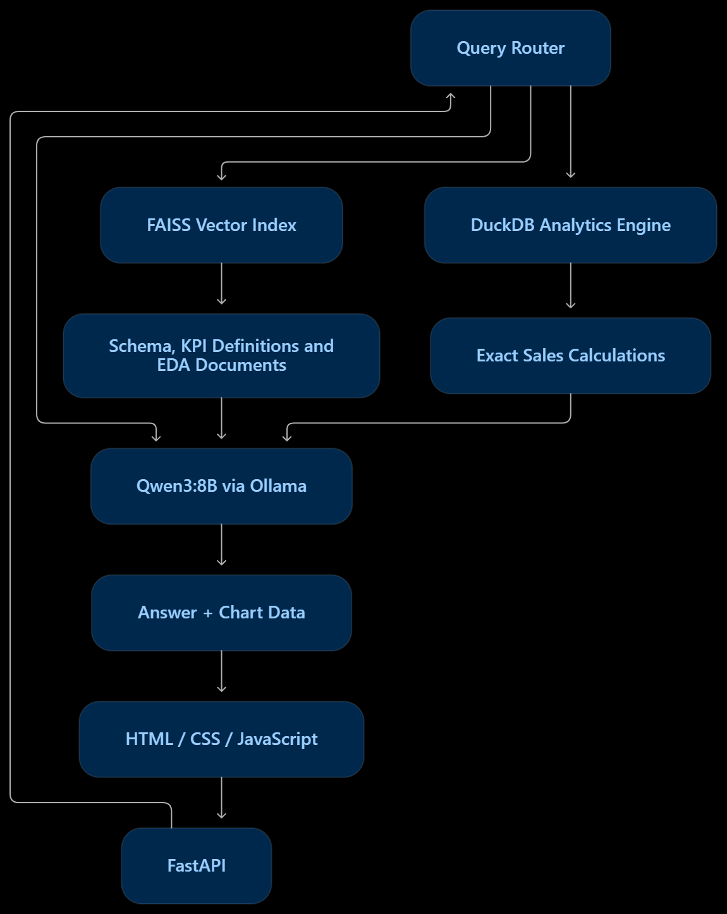

# Sales Insight Chatbot

A fully local AI chatbot for the **Amazon India Q2 2022 sales data** (`Amazon_Sale_Report_1.csv`), built on the
stack from the architecture diagrams in `docs/`:

| Component        | Technology                         | Where in the code |
|------------------|------------------------------------|-------------------|
| Frontend         | HTML, CSS, JavaScript              | `frontend/` |
| Backend          | Python + FastAPI                   | `app/main.py` |
| LLM              | Qwen3:8B Q4_K_M                    | `app/core/llm.py`, `app/core/prompts.py` |
| Model runtime    | Ollama                             | REST API at `http://127.0.0.1:11434` |
| Vector search    | FAISS                              | `app/core/vector_store.py` |
| Embedding model  | all-MiniLM-L6-v2                   | `app/core/embeddings.py` |
| Sales analytics  | DuckDB                             | `app/core/analytics.py`, `app/core/sql_agent.py` |
| Charts           | Chart.js 4.4.1 (bundled, offline)  | `frontend/js/charts.js` |
| Hardware         | RTX 5070 12 GB VRAM                | ~6.5 GB used at the default 8K context |

Nothing leaves your machine: no cloud API, no CDN (Chart.js is vendored), and the data stays in a local DuckDB file.

---

## How it works



```
Browser (HTML/CSS/JS) ──POST /api/chat──► FastAPI
                                           │
                                     Query Router  (keyword rules + FAISS kNN over labelled examples,
                                           │        LLM tie-break only when unsure)
          ┌────────────────────────────────┼─────────────────────────────┐
     analytics                         knowledge                       general
          │                                │                             │
 FAISS: similar SQL examples      FAISS: schema, KPI definitions,        │
 + KPI definitions                EDA methodology & insights             │
          │                                │                             │
 Qwen3 writes DuckDB SQL (JSON)            │                             │
 → validated read-only → DuckDB            │                             │
 → exact rows (retry on error)             │                             │
          └──────────────► Qwen3:8B via Ollama (streamed) ◄──────────────┘
                                           │
                       Answer + SQL + data table + Chart.js chart + sources
```

**Why numbers are trustworthy.** The LLM never does arithmetic on the raw data. For analytics questions it only
*writes SQL*; DuckDB computes the figures; the LLM then explains the exact result it is handed, and the chart and
table are built directly from the DuckDB rows. The DuckDB build reproduces the EDA notebook's cleaning steps
exactly, so the bot's numbers match the notebook (April ₹28,838,708.32, May ₹26,224,517.75, June ₹23,424,646.38,
18,316 cancelled lines, 2,109 returned lines). These are checked by `tests/test_core.py`.

**Safety of generated SQL.** DuckDB is opened read-only with external file access disabled, and every query must
pass a validator (single `SELECT`/`WITH`, no DDL/DML/`COPY`/`ATTACH`/`PRAGMA`/file-reading functions), with a
row cap and a 15 s timeout. Failed queries are sent back to Qwen3 with the error message (up to 2 retries); if
they still fail, the bot answers from the knowledge base and says so.

---

## Project structure

```
sales-chatbot/
├── app/
│   ├── main.py              FastAPI app, endpoints, serves the frontend
│   ├── config.py            all settings (env vars / .env)
│   ├── schemas.py           request models
│   └── core/
│       ├── engine.py        ChatEngine: wires router → SQL/RAG → LLM, streams events
│       ├── router.py        Query Router (rules + FAISS kNN + LLM fallback)
│       ├── sql_agent.py     text-to-SQL with retrieval, validation, retries
│       ├── analytics.py     DuckDB build (notebook cleaning), safe query runner, KPIs
│       ├── knowledge.py     markdown chunking, SQL examples, generated EDA docs
│       ├── vector_store.py  FAISS IndexFlatIP (+ NumPy fallback)
│       ├── embeddings.py    all-MiniLM-L6-v2 (sentence-transformers, or Ollama fallback)
│       ├── llm.py           async Ollama client (stream, JSON schema output, <think> filter)
│       ├── charts.py        DuckDB result → Chart.js spec
│       └── prompts.py       every prompt in one place
├── knowledge/               what FAISS searches (edit freely, index rebuilds automatically)
│   ├── dataset_overview.md  schema.md  kpi_definitions.md  eda_methodology.md
│   ├── sql_examples.md      question → SQL few-shot examples (26, all tested)
│   ├── router_examples.json labelled utterances for the router
│   └── generated/           column_values.md, eda_insights.md (computed from the data)
├── frontend/                index.html, css/styles.css, js/{app,charts,markdown}.js, vendor/chart.umd.min.js
├── data/                    Amazon_Sale_Report_1.csv
├── storage/                 sales.duckdb + FAISS indexes (generated)
├── scripts/                 ingest.py, check_setup.py, eval_questions.py
├── tests/test_core.py
├── setup.ps1 / run.ps1 / run.bat   (Windows)    setup.sh / run.sh (Linux/macOS)
└── requirements*.txt, .env.example
```

---

## Quick start (Windows, PowerShell)

Prerequisites: **Python 3.12**, **Ollama** (https://ollama.com/download), a recent NVIDIA driver.

```powershell
cd sales-chatbot
Set-ExecutionPolicy -Scope Process -ExecutionPolicy Bypass   # only if scripts are blocked
.\setup.ps1          # venv, packages, PyTorch cu128, ollama pull qwen3:8b-q4_K_M + all-minilm, build DB & indexes
.\run.ps1            # starts the server and opens http://127.0.0.1:8000
```

`setup.ps1` options:

| Option       | Use when |
|--------------|----------|
| *(none)*     | Default. PyTorch `2.11.0+cu128` (supports the RTX 5070 / Blackwell) for the embedder. |
| `-CpuTorch`  | Smaller download; MiniLM is tiny and fast on CPU anyway. |
| `-NoTorch`   | PyTorch can't be installed or is blocked (e.g. Application Control blocking a torch DLL). Embeddings then come from Ollama's `all-minilm`, which is the same all-MiniLM-L6-v2 model. |

Manual install, if you prefer:

```powershell
py -3.12 -m venv .venv
.\.venv\Scripts\python.exe -m pip install -r requirements.txt
.\.venv\Scripts\python.exe -m pip install torch==2.11.0 --index-url https://download.pytorch.org/whl/cu128
.\.venv\Scripts\python.exe -m pip install -r requirements-embeddings.txt
ollama pull qwen3:8b-q4_K_M
ollama pull all-minilm
.\.venv\Scripts\python.exe scripts\ingest.py
.\.venv\Scripts\python.exe run.py
```

The model tag used is `qwen3:8b-q4_K_M` (Qwen3 8B, Q4_K_M quantisation, ~5.2 GB). To try another Ollama model,
pull it and set `LLM_MODEL=<tag>` in `.env`.

---

## Using it

Ask in plain English, for example:

- *What was the total revenue by month?* → bar chart + exact table
- *Top 10 states by revenue* → then *and only for kurta?* (follow-ups keep context)
- *Compare Amazon vs Merchant fulfilment* · *Which sizes sell the most?* · *Show the daily revenue trend*
- *How is AOV calculated?* · *Why was March removed?* · *What are the key insights from the EDA?*

Every analytics answer shows a route badge, the generated SQL (copyable), the data table (CSV download) and a chart
(switch Bar / Rows / Line / Donut, PNG download). The **Answer path** selector in the sidebar can force a route.

### API

| Method | Path              | Purpose |
|--------|-------------------|---------|
| GET    | `/api/health`     | Ollama reachability, model installed/loaded, VRAM used, embedder, FAISS, DuckDB rows |
| GET    | `/api/overview`   | KPI cards + starter charts |
| GET    | `/api/suggestions`| Example questions |
| POST   | `/api/chat`       | Streamed answer, NDJSON events: `route`, `sql`, `sql_error`, `table`, `chart`, `sources`, `token`, `error`, `done` |
| POST   | `/api/chat/sync`  | Same, as one JSON object |
| POST   | `/api/sql`        | Run a read-only SQL query (disable with `ENABLE_SQL_CONSOLE=false`) |
| GET    | `/docs`           | Swagger UI |

Request body for chat: `{"message": "...", "history": [{"role": "user", "content": "..."}, ...], "route": null}`.

---

## Configuration

Copy `.env.example` to `.env` (setup does this). Most useful settings:

| Setting | Default | Notes |
|---|---|---|
| `LLM_MODEL` | `qwen3:8b-q4_K_M` | Any Ollama chat model works. |
| `LLM_NUM_CTX` | `8192` | 16384 still fits in 12 GB. |
| `LLM_THINK` | `false` | Qwen3 reasoning mode; better on hard questions, much slower. |
| `EMBED_BACKEND` | `auto` | `sentence-transformers`, `ollama`, or `auto` (ST, falling back to Ollama). |
| `EMBED_DEVICE` | `auto` | `cuda` when PyTorch sees the GPU, else `cpu`. |
| `ROUTER_LLM_FALLBACK` | `true` | Ask Qwen3 to classify only when rules + kNN are unsure. |
| `SQL_RETRIES` | `2` | Self-correction attempts for failed SQL. |

**VRAM budget on the RTX 5070 (12 GB):** Qwen3 8B Q4_K_M weights ≈ 5.2 GB + KV cache at 8K ≈ 1.2 GB; MiniLM on
CUDA ≈ 0.3 GB. You can also set these *Ollama* environment variables (system-wide, then restart Ollama) for a
smaller KV cache and faster attention: `OLLAMA_FLASH_ATTENTION=1`, `OLLAMA_KV_CACHE_TYPE=q8_0`.

FAISS runs on the CPU on purpose: the indexes hold ~150 vectors, so search takes well under a millisecond and all
VRAM stays available for the LLM.

---

## Extending

- **Better SQL for a type of question:** add a `## Title / Question: / Chart: / ```sql``` ` block to
  `knowledge/sql_examples.md`. Run `python -m pytest` to make sure it executes.
- **Routing mistakes:** add the misrouted phrasing to `knowledge/router_examples.json` under the right route.
- **New business knowledge** (targets, glossary, commentary): drop a markdown file in `knowledge/` using `##`
  sections. Indexes rebuild automatically on next start (a fingerprint of the folder is checked).
- **Another dataset:** change `build_database()` in `app/core/analytics.py`, `COLUMN_NOTES` in
  `app/core/sql_agent.py`, the markdown in `knowledge/`, then `python scripts/ingest.py --force`.
- **Prompts:** all in `app/core/prompts.py`.

Rebuild everything after changing the CSV: `python scripts/ingest.py --force`.

---

## Testing

```powershell
.\.venv\Scripts\python.exe -m pytest -q                 # 23 tests, no GPU or Ollama needed
.\.venv\Scripts\python.exe scripts\eval_questions.py    # with the server running: batch-asks real questions
```

---

## Troubleshooting

| Symptom | Fix |
|---|---|
| Header pill says **Ollama not running** | Start Ollama (tray app or `ollama serve`). |
| **Model missing** | `ollama pull qwen3:8b-q4_K_M` |
| `WinError 4551` / a DLL blocked when importing torch | Application Control is blocking a PyTorch file. Re-run `.\setup.ps1 -NoTorch` (or set `EMBED_BACKEND=ollama`). Nothing else changes. |
| `pip.exe` blocked in the venv | Always use `python -m pip ...` (the scripts already do). |
| First answer is slow | The model is loading into VRAM; it is pre-loaded at startup and kept for `LLM_KEEP_ALIVE` (30 min). |
| Answers show reasoning text | Make sure Ollama is up to date (≥ 0.9 supports `think: false`); `<think>` blocks are also stripped by the client. |
| A question gets the wrong SQL | Add a similar example to `knowledge/sql_examples.md`; or try `LLM_THINK=true`. |
| Port 8000 in use | Set `PORT=8010` in `.env`. |
| `faiss` import fails | Search silently falls back to NumPy (identical results). Run `scripts/check_setup.py` to see what's loaded. |

---

Data: Kaggle "Unlock profits with e-commerce sales data" (Amazon Sale Report). Chart.js is MIT licensed.
